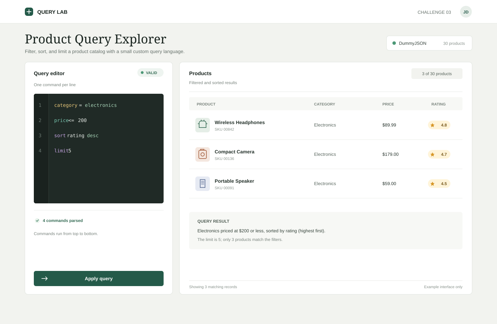

# Challenge 3: Product Query Explorer

## Goal

Build a small product-listing application that lets users enter commands in a **custom query language** to filter, sort, and limit the displayed products. The application must parse user input, validate it, and apply the resulting rules to product data.

The goal is to demonstrate frontend implementation, algorithmic thinking, input validation, and maintainable code—not pixel-perfect styling.

- **Target level:** Medior Frontend Developer
- **Duration:** 60 minutes
- **Technologies:** TypeScript, Vue / React
- **Format:** Live coding with the interviewer



_Illustrative reference only; candidates are not expected to match the design._

## Rules and Tooling

- **AI assistance is forbidden during the live coding session.** Do not use ChatGPT, GitHub Copilot, AI-enabled IDE agents, AI code completion, or other generative AI tools to write, explain, or debug code.
- You may consult official documentation (for example, React, JavaScript, TypeScript, and the chosen API's documentation).
- **Libraries, frameworks, UI kits, and testing tools are the candidate's choice**, provided the application is built with Vue or React. Be ready to explain your choices.
- You may use JavaScript or TypeScript; TypeScript is encouraged but not mandatory.
- You may use any of the public APIs listed below **or create your own mock server**. A local static JSON dataset is also acceptable if external connectivity becomes a problem.
- You may ask the interviewer clarifying questions and explain trade-offs as you work.

## Product Data Source

Choose **one** of the following options. External APIs may have changing availability, limits, and response schemas; verify the API before the interview. Fetching data is not the core algorithmic challenge.

| Option         | Public API / approach                                     | Example                                       | Notes                                                                                           |
| -------------- | --------------------------------------------------------- | --------------------------------------------- | ----------------------------------------------------------------------------------------------- |
| DummyJSON      | [DummyJSON Products](https://dummyjson.com/docs/products) | `https://dummyjson.com/products?limit=30`     | Product titles, categories, prices, ratings, stock; straightforward choice.                     |
| Fake Store API | [Fake Store API](https://fakestoreapi.com/)               | `https://fakestoreapi.com/products`           | Product title, category, price, and nested rating data.                                         |
| PokéAPI        | [PokéAPI v2](https://pokeapi.co/docs/v2)                  | `https://pokeapi.co/api/v2/pokemon/?limit=30` | Pokémon data includes names, types, base experience, and stats; fetch detail records as needed. |
| Star Wars API  | [SWAPI](https://swapi.dev/documentation)                  | `https://swapi.dev/api/starships/`            | Starships include class, cost in credits, and hyperdrive rating; results are paginated.         |
| Mock server    | Your own mock endpoint                                    | `http://localhost:3001/products`              | Any implementation or mock-server library.                                                      |
| Local fixture  | Static JSON                                               | `src/data/products.json`                      | Acceptable fallback for network/API issues.                                                     |

Choose a domain API even if it is not a product catalog, and normalize its data to the required shape. For example, with PokéAPI use base experience as `price` and average base stats divided by 20 as `rating`; with SWAPI starships use `cost_in_credits` as `price` and `hyperdrive_rating` as `rating`. Parse numeric strings and handle nonnumeric values such as `unknown` consistently. The query behavior matters more than the real-world meaning of `price` or `rating`. Include at least 10 normalized records. Each product displayed in the app should have at least:

```ts
type Product = {
  id: number;
  title: string;
  category: string;
  price: number;
  rating: number;
};
```

Additional fields such as `stock`, `brand`, or `thumbnail` are optional. Use at least 10 products for meaningful results.

## Core Requirements

### 1. Product listing

- Load products from the chosen data source.
- Display product title, category, price, and rating.
- Show appropriate loading, error, and empty-result states.
- Basic styling is sufficient; responsive layout is a plus.

### 2. Custom query editor

Provide a text input or textarea where users can write one command per line. A button such as **Apply query** should parse and execute the commands.

Supported commands:

| Syntax                             | Example                  | Meaning                                                              |
| ---------------------------------- | ------------------------ | -------------------------------------------------------------------- |
| `price <number-comparison> value`  | `price < 100`            | Filter by price.                                                     |
| `rating <number-comparison> value` | `rating >= 4.5`          | Filter by rating.                                                    |
| `category = value`                 | `category = electronics` | Filter by category (case-insensitive).                               |
| `sort field direction`             | `sort price desc`        | Sort by `price`, `rating`, or `title`; direction is `asc` or `desc`. |
| `limit number`                     | `limit 5`                | Keep at most the specified number of products.                       |

For numeric fields, support `<`, `<=`, `>`, `>=`, and `=`. String equality is case-insensitive. Whitespace around operators may vary, but commands must otherwise follow the documented syntax.

**Execution semantics:** Commands are processed **top to bottom**. Multiple filter commands are combined using logical AND. A `sort` or `limit` command takes effect at its position in the sequence. Sorting must not mutate the original product dataset.

Example:

```text
category = electronics
price <= 200
sort rating desc
limit 5
```

This should show up to five electronics products costing no more than 200, ordered by rating from highest to lowest.

### 3. Parsing and validation

- Parse each nonempty line into a structured command.
- Validate command names, fields, operators, directions, and value types.
- Show understandable validation messages, ideally with line numbers.
- If any command is invalid, **do not execute the query partially**. Show the errors and keep the previously displayed results (or clearly indicate that no new query was applied).
- An empty query displays all products in their original order.
- A valid query with zero matches displays a clear empty state.

Invalid examples:

```text
price >> 100
rating >= abc
sort unknown desc
limit -2
color = red
```

### 4. Maintainability

Keep parsing/validation logic reasonably separate from React rendering. You should be able to explain how to test the parser and query execution independently.

## Suggested time allocation

| Time      | Focus                                             |
| --------- | ------------------------------------------------- |
| 0–5 min   | Read requirements and choose a data source        |
| 5–15 min  | Load and display products; build query input      |
| 15–30 min | Parse and validate query commands                 |
| 30–45 min | Implement filtering, sorting, and limit           |
| 45–55 min | Handle errors, combined commands, and edge cases  |
| 55–60 min | Explain design choices and potential improvements |

Prioritize working core functionality over visual polish.

## Example acceptance scenarios

1. Empty query → all products in original order.
2. `price < 100` → only products priced below 100.
3. `category = electronics` → category matches regardless of letter case.
4. `rating >= 4.5` followed by `sort price asc` → filtered products ordered by increasing price.
5. `sort price desc` followed by `limit 3` → the three most expensive products.
6. `limit 3` followed by `sort price desc` → sort only the first three products; command order matters.
7. `price < abc` → validation error; do not partially apply the query.
8. `price < 0` → valid query with an empty-result state (assuming nonnegative prices).
9. Reapplying a query does not mutate the original data or produce accumulating side effects.

## Optional Extensions

- Add `stock > 0` filtering if the data source provides stock information.
- Support `!=` for numeric or string comparisons.
- Add a query history or example-query presets.
- Add unit tests for parsing and execution.
- Discuss how to support `AND`, `OR`, parentheses, or operator precedence.
- Discuss how you would handle a very large dataset or server-side filtering.

These extensions are **not required** for a successful interview.
